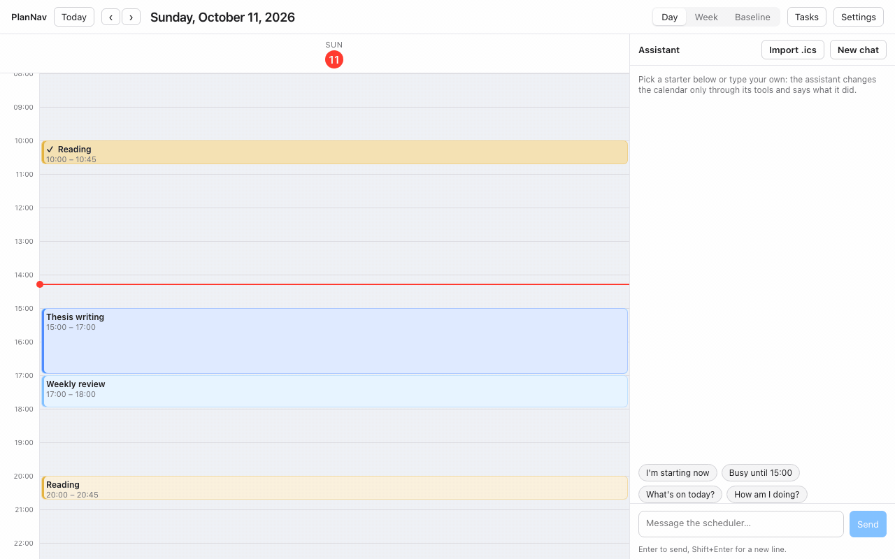
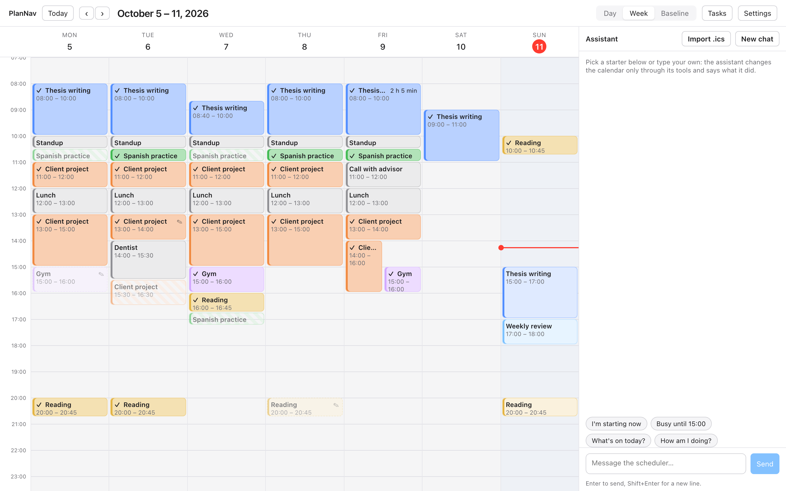
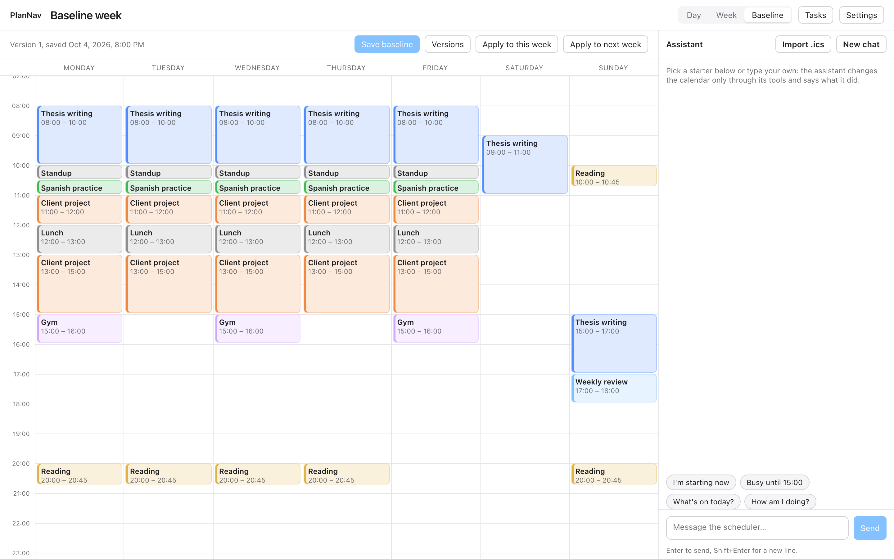

# RerouteDay

[](https://www.npmjs.com/package/rerouteday) [](LICENSE)

A local-first calendar that plans your week from a baseline and adjusts the day when life interrupts.

You keep one template week, your **baseline**: the task slots and busy slots you want a normal week to have. Every real week starts as a copy of it. When the day goes off plan, you tell the assistant in a chat box next to the calendar, and it moves things with tested scheduling functions instead of guessing. Your data stays in a SQLite file on your machine.



Two messages, no editing by hand. "I'm starting now" is a direct action: the server recognises it and shifts the rest of the day on the spot, without a model call. The second message goes to the assistant, which picks the carve-out tool, splits the thesis block around the pickup, moves what follows, and says exactly what it did.



One week, as it happened, for a made-up grad student with a freelance client. Every change on it came from a sentence to the assistant or a click on a block:

- **Tuesday:** "Busy from 14:00 to 15:30, dentist" carved the hour out and split the client block around it.
- **Wednesday:** "I'm starting now" at 08:40 shifted the rest of the day later, and "I didn't finish Spanish" carried the missed 30 minutes to the first blank gap.
- **Monday and Thursday:** a skipped gym session and a skipped reading block, each with a note the assistant will see next time it plans.
- **Friday:** the thesis block was tracked from Start to Finish and shows the actual time, then an advisor call pushed the afternoon later.
- **Hatched blocks** were never marked and became missed, so the record stays honest.

The week came from this baseline, the template every week starts as:



## Quick start

```bash
npx rerouteday
```

Or install it once and run `rerouteday` from anywhere:

```bash
npm install -g rerouteday
rerouteday
```

Your browser opens on http://127.0.0.1:4820 once the server is up (pass `--no-open` or set `REROUTEDAY_OPEN=0` to skip that). Pick an assistant backend in **Settings**: the Claude Code CLI if `claude` is on your PATH, or an Anthropic API key. Needs Node 22.13 or newer.

From source:

```bash
pnpm install
pnpm dev        # API on http://localhost:4820, UI on http://localhost:5173
pnpm start      # production build served from one port
```

Data lives in `~/.rerouteday/data.sqlite`. Set `REROUTEDAY_DB_PATH` to move it and `PORT` to change the port.

## Why

Most planners make you rebuild the week from scratch or let an AI rewrite your calendar freely. RerouteDay does neither:

- The baseline is the source of truth. A week is the baseline applied, then adjusted day by day. Nothing is replanned behind your back.
- The assistant can only act through a fixed set of scheduling tools (shift the day, carve out an hour, carry over unfinished work, apply the baseline). Each tool is pure, deterministic and unit tested. The model picks the tool; the code decides the result.
- Everything is local. The server runs on your machine, the database is a file you own, and the only network call is to the assistant backend you choose.

## What it does

- **Set up in one line.** Import a past week as your baseline from an `.ics` file or a Google Calendar secret iCal address, draw it on the Baseline tab, or add tasks and hours and ask for a suggested week.
- **Apply the baseline** to this week or next. A re-apply keeps what you moved by hand and tells you what it could not place.
- **Adjust the day in plain words.** "I'm starting now" shifts the rest of the day later by how late you are, breaks kept; if that runs past your day's end, it asks whether to waive the breaks or end later. "Busy from 14:00 to 15:00" carves the hour out and pushes what follows. "I didn't finish X" carries the remaining minutes to the next gap.
- **Edit directly.** Drag blocks, resize them, mark them done or skipped, copy and paste them, or type "move X to 10".
- **It remembers how you like changes.** After you answer a question like "waive the breaks or end later?", it offers to remember your answer. The note lives in Settings, where you can edit or clear it.
- **Track what actually happened.** Start, pause and finish a block, or say "I spent 45 minutes on reading". Finishing a block you never started counts it as done as planned. Unmarked blocks become missed, so the record is complete from day one.
- **Leave notes** on any block. The assistant reads the last two weeks of notes when it plans.
- **Import and export.** Pull commitments from Apple Calendar or Google Calendar exports, and export the whole calendar as `.ics` or JSON.
- **Version your baseline.** "This is my baseline" saves the current week as a new version; revert to any earlier one from the Baseline tab.

## Requirements

- Node 22.13 or newer. RerouteDay uses the built-in `node:sqlite`.
- pnpm, to run from source.
- An assistant backend: the Claude Code CLI installed and logged in, or an Anthropic API key.

## Choosing the assistant backend

Open **Settings** in the toolbar.

- **Claude Code subscription** (default). The server runs `claude -p` headlessly and hands it an MCP server that exposes the scheduling tools. Nothing to configure if `claude` is on your PATH.
- **Anthropic API key.** Paste your key. It is stored in the local database and sent only to the Anthropic API. The default model is `claude-opus-5-5`.

Both backends share the same tool definitions and system prompt.

## Project layout

```
packages/core     scheduling logic, budgets, stats, iCalendar import and export, tool definitions (pure, tested)
packages/server   Hono API, SQLite store, assistant providers, MCP server, static serving
packages/web      Vite + React calendar and chat panel
packages/bench    friction benchmark: scenarios, dialogues and scorer for the planner
packages/rerouteday  the npm package: bundles server, core and the built UI into `npx rerouteday`
```

## Development

```bash
pnpm test         # all packages
pnpm typecheck
pnpm build        # also bundles packages/rerouteday
pnpm bench        # planner friction benchmark (deterministic, seconds)
```

## Releases

RerouteDay is published on npm as [rerouteday](https://www.npmjs.com/package/rerouteday). Each version's notes are in [RELEASELOG.md](RELEASELOG.md).

## License

Apache-2.0. Copyright 2026 jycd25.

See [packages/bench/README.md](packages/bench/README.md) for how the benchmark scores a plan.
